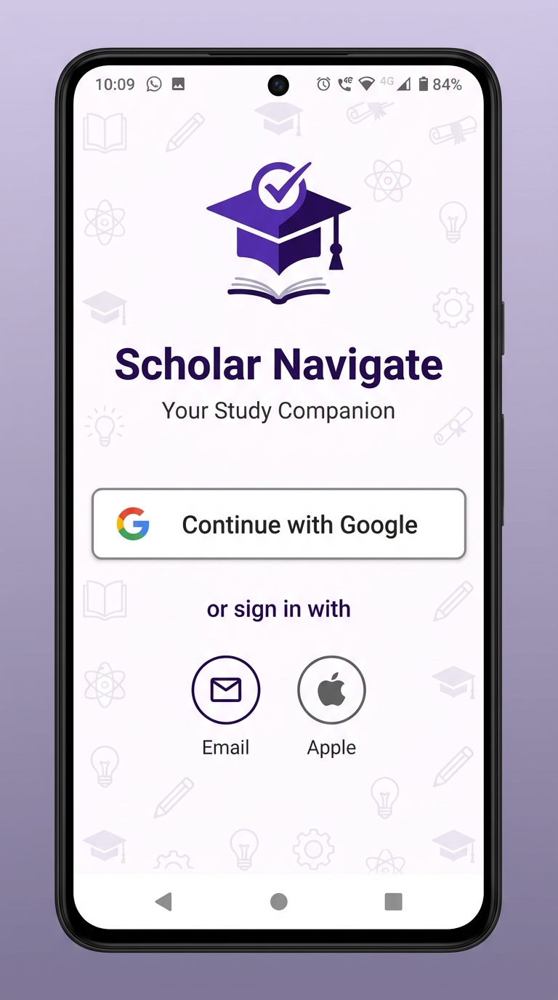
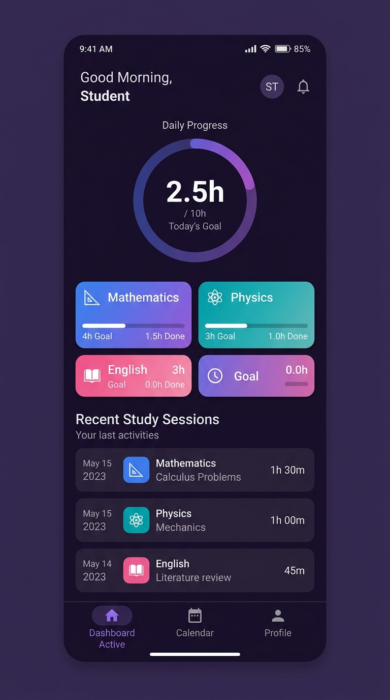
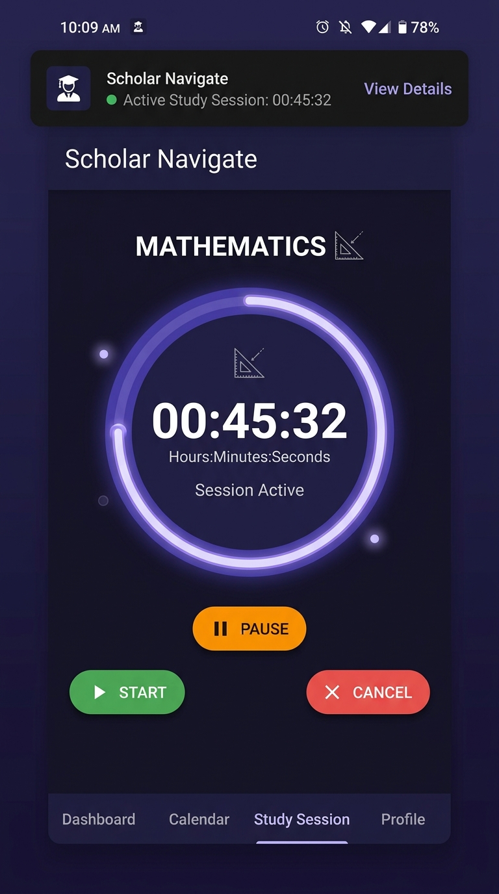
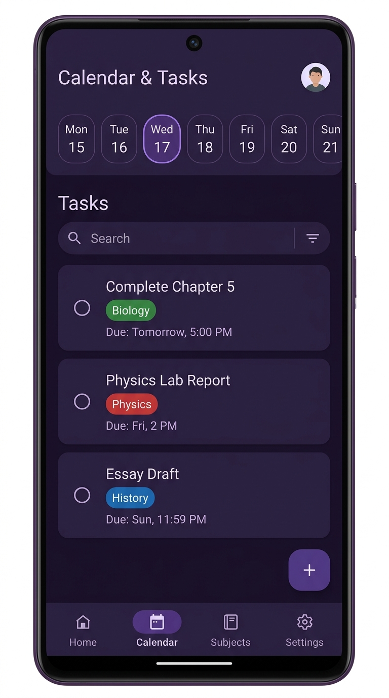

# 📚 Scholar Navigate

> **Your personal study companion** — track subjects, time study sessions, manage tasks, and hit your learning goals.

Built with **Jetpack Compose** · **Firebase** · **Room** · **Hilt** · **MVVM**

---

## 📸 Screenshots

<p align="center">
  
  &nbsp;
  
  &nbsp;
  
  &nbsp;
  
</p>

---

## ✨ Features

- 🔐 **Google Sign-In** via Firebase Authentication
- 📊 **Dashboard** — progress ring, subject cards, recent sessions at a glance
- ⏱️ **Study Timer** — foreground service keeps the timer running in the background with live notification
- 📅 **Calendar & Tasks** — horizontal date strip, per-day task list, checkboxes
- 📚 **Subjects (Courses)** — create courses with color themes, goal hours, and syllabus
- 🗂️ **Task Management** — create, edit, complete and filter tasks by subject
- 📈 **Progress Tracking** — total studied hours vs goal hours per subject
- 🌙 **Dark / Light theme** with dynamic Material You colors (Android 12+)
- 📱 **Edge-to-edge full screen** UI

---

## 🛠️ Tech Stack

| Category | Technology |
|----------|-----------|
| Language | Kotlin |
| UI | Jetpack Compose, Material Design 3 |
| Architecture | MVVM, Clean Architecture |
| DI | Hilt (Dagger) |
| Local DB | Room + TypeConverters |
| Auth | Firebase Authentication (Google Sign-In) |
| Navigation | Navigation Compose |
| Background | Foreground Service (study timer) |
| Async | Kotlin Coroutines + Flow + StateFlow |
| Image Loading | Coil |

---

## 🚀 Getting Started

### Prerequisites
- Android Studio Hedgehog or later
- Android SDK 34
- A Firebase project with Google Sign-In enabled

### 1. Clone the repo
```bash
git clone https://github.com/Opeoluwa-Muritala/Scholar_Navigate_New.git
cd Scholar_Navigate_New
```

### 2. Add Firebase config
1. Go to [Firebase Console](https://console.firebase.google.com) → your project
2. Add an Android app with package name `com.example.scholarnavigate`
3. Add your **SHA-1** debug fingerprint (get it with the command below)
4. Download `google-services.json` → place in `app/`

```bash
# Get your debug SHA-1
./gradlew signingReport
```

### 3. Build & run
```bash
# Install on connected device
./gradlew :app:installDebug
```

---

## 📁 Project Structure

```
app/src/main/java/com/example/scholarnavigate/
├── data/
│   ├── database/          # Room DB, DAOs, repositories, Hilt modules
│   ├── module/            # Entity data classes (Course, Session, Task, User)
│   └── uimodule/          # UI state classes
├── navigate/              # Navigation graphs and route definitions
├── ui/
│   ├── components/        # Shared composables (SingleRowCalendar, CountCard…)
│   ├── screen/            # Feature screens (dashboard, calendar, login, splash…)
│   └── theme/             # Material theme, colors, typography
└── viewmodels/            # Hilt ViewModels for each screen
```

---

## 🐛 Bug Fixes Applied

26 crash-causing bugs were identified and fixed including:

- ✅ `IllegalArgumentException` — `unbindService` called when never bound
- ✅ Study timer never started — `stopService` was called before `startService`
- ✅ `SecurityException` on Android 14 — invalid `foregroundServiceType`
- ✅ `NullPointerException` — `SUM()` on empty Room table
- ✅ `NumberFormatException` — empty color string in Room TypeConverter
- ✅ Google Sign-In race condition — `isUserLoggedIn()` always returned `false`
- ✅ Main thread database access in UserDao and SessionDao
- ✅ Backstack not cleared after login / logout double-navigation
- ✅ `hilt-navigation-compose` version incompatibility with lifecycle 2.8

---

## 📄 License

```
MIT License — see LICENSE file for details
```
